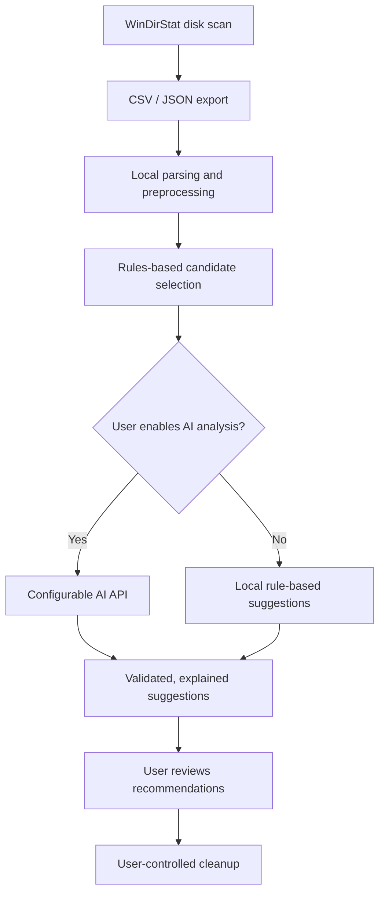

# AI-Assisted Disk Space Analysis and File Organisation Tool

**AI-powered disk cleanup recommendations built on WinDirStat**  
**Course:** Contemporary Methods in Software Engineering  
**Project status:** Planning / prototype development  
**Project type:** Student project based on an open-source application

> **Disclaimer:** This is an independent course project, not an official WinDirStat release or an endorsement by the WinDirStat team. Features marked **Planned** are project goals and are not yet available.

## 1. Project Overview

[WinDirStat](https://github.com/windirstat/windirstat) is an open-source disk usage analyzer for Microsoft Windows. It can scan disks and folders, visualize storage usage, identify large or duplicate files, and export scan results in CSV or JSON format.

This course project aims to **extend WinDirStat with AI-assisted disk cleanup recommendations**. Rather than only showing which files occupy space, the proposed extension will help users understand **what they could review, why it may be worth reviewing, how much space might be recovered, and what risks to consider**.

The AI will act as a **decision-support assistant**, not an automatic file deletion tool. Users remain responsible for reviewing and approving all cleanup actions.

### Problem Statement

Traditional disk analyzers make storage usage visible, but users may still have difficulty distinguishing potentially unnecessary files from important system, application, or personal files. Our project explores whether a combination of scan metadata, deterministic safety rules, and an AI API can produce understandable and actionable cleanup suggestions.

### Project Goals

- Reuse WinDirStat's existing scanning and visualization capabilities.
- Analyze exported scan metadata to identify cleanup candidates.
- Integrate a configurable AI API to explain and prioritize suggestions.
- Include potential space savings, reasoning, and risk warnings in each suggestion.
- Protect user privacy and prevent accidental deletion.
- Evaluate the quality, clarity, and safety of the recommendations.

## 2. Existing Features vs. Proposed Extension

| Capability | Status | Source |
| --- | --- | --- |
| Scan local drives and folders | Existing | WinDirStat |
| Visualize file and folder sizes | Existing | WinDirStat |
| Inspect large files and detect duplicates | Existing | WinDirStat |
| Export scan results to CSV or JSON | Existing | WinDirStat |
| Extract and rank cleanup candidates from scan data | Planned | Course project |
| Use an AI API to generate explanations and recommendations | Planned | Course project |
| Present storage savings estimates and risk indicators | Planned | Course project |
| Allow users to review recommendations before acting | Planned | Course project |
| Automatically delete files based on AI output | **Out of scope** | Safety decision |

## 3. Proposed User Workflow

1. **Scan:** The user scans a drive or folder using WinDirStat.
2. **Export:** The user exports the scan result as CSV or JSON using WinDirStat's existing feature.
3. **Preprocess locally:** The extension selects relevant metadata, aggregates storage usage, flags incomplete scan data, and removes or minimizes sensitive information where feasible.
4. **Analyze:** A rules-based filter identifies candidate items. With the user's consent, a limited dataset is sent to the configured AI API for additional explanations and prioritization.
5. **Review:** The user sees suggestions, estimated recoverable space, justifications, and risk levels.
6. **Clean manually:** The user checks the proposed items before taking any action using existing Windows or WinDirStat tools.



**Why start with file exports?** WinDirStat already supports saving scan results. Using that boundary makes it possible to prototype and test the AI extension independently before considering deeper integration into the Windows desktop application.

## 4. Planned AI Recommendation Features

### Candidate identification

Potential candidates may include large downloads, old installation packages, redundant copies, and other high-usage items. These are **review candidates only**: file age, size, type, or location alone is not proof that a file is safe to remove. Duplicate recommendations must distinguish verified duplicates from probable matches.

### Explainable recommendations

For each candidate, the extension aims to show:

| Field | Example of intended output |
| --- | --- |
| Item | A user-selected download or folder (displayed locally) |
| Estimated space | Size of the candidate item; not necessarily guaranteed recoverable space |
| Recommendation | Review whether an old installer is still needed |
| Reason | Large item in a download location; may be an obsolete installer |
| Risk | Medium — user confirmation required |
| Suggested action | Inspect in File Explorer; delete only if no longer required |

### Fallback behavior

The application should still provide basic, locally generated candidates if AI access is disabled, the API key is missing, the external service is unavailable, or an API response cannot be validated.

## 5. System Design (Proposed)

The initial integration is envisioned as an independent component that consumes WinDirStat reports. The exact programming language, API provider, and UI framework have **not yet been finalized**.

| Component | Responsibility |
| --- | --- |
| WinDirStat | Scan storage and export structured reports |
| Report parser | Read supported export formats and handle missing/incomplete data |
| Privacy-aware preprocessor | Aggregate metadata, minimize identifiers, and limit API payload size |
| Candidate/risk rules | Identify review candidates and exclude or warn about protected locations |
| AI adapter | Call a configurable API; manage failures, timeouts, and response validation |
| Recommendation view | Present explanations, estimated savings, and warnings |

API responses will be treated as **untrusted suggestions**. A local validation layer should check output structure, candidate references, and allowed actions before any recommendation is displayed. File paths and file names should also be treated as untrusted input, not executable instructions.

## 6. MVP Scope and Acceptance Criteria

The first demonstrable version will focus on **one local scan-report workflow**, rather than implementing every possible WinDirStat storage backend.

- [ ] Import a real WinDirStat CSV or JSON scan export.
- [ ] Extract a limited set of high-storage candidates and display their sizes.
- [ ] Generate readable recommendations using an AI API (when explicitly enabled).
- [ ] Include a reason and a risk warning for each recommendation.
- [ ] Handle API errors and invalid responses without crashing.
- [ ] Operate without automatically deleting or moving any files.
- [ ] Demonstrate a local-only fallback for basic candidate identification.
- [ ] Document test cases, known limitations, and evaluation findings.

**Possible future enhancements:** direct integration inside WinDirStat's UI, configurable recommendation categories, user feedback, and deeper duplicate analysis. These are not MVP commitments.

## 7. Privacy and Safety

Disk metadata can reveal sensitive information. The design therefore follows these principles:

- **Explicit opt-in:** Never send scan metadata to an external AI service without the user's consent.
- **Data minimization:** Prefer aggregate statistics, file categories, and anonymized identifiers; only transmit raw paths or names if essential and explicitly approved.
- **No file contents:** The proposed AI workflow operates on metadata, not the contents of personal files.
- **No credential exposure:** Do not include passwords, API keys, cloud credentials, or private configuration values in API requests or logs.
- **No automatic deletion:** AI output must never directly trigger destructive actions.
- **Protected locations:** System directories, application data, and other sensitive areas require special caution; uncertain items should not be recommended for deletion.
- **Honest estimates:** Warn when scans are incomplete, duplicate matches are only probable, or physical storage savings cannot be determined.
- **Secure configuration:** Keep API keys out of source control, for example via environment variables and a Git-ignored local configuration file.

The final implementation should document exactly which fields are sent to the chosen AI provider, how errors are handled, and whether the provider retains data. These details are **pending implementation and provider selection**.

## 8. Getting Started

### A. Use the existing WinDirStat application

Install the official WinDirStat release from its [GitHub releases page](https://github.com/windirstat/windirstat/releases/) or from its [official website](https://windirstat.net/). Alternatively, on supported Windows systems:

```powershell
winget install -e --id WinDirStat.WinDirStat
```

In WinDirStat, choose a drive or folder to scan, explore the results, and use **File > Save Results To CSV/JSON** to export a scan snapshot.

**Important:** Installing official WinDirStat does **not** install this course project's AI extension.

### B. Build the upstream application from source

The uploaded upstream README describes opening `windirstat.sln` in Visual Studio with the C++ desktop workload, MSVC v145 (C++23 support), ATL, and a Windows SDK. Git and Windows PowerShell are required by the upstream build scripts; the first build may download xxHash if needed. See the [upstream repository](https://github.com/windirstat/windirstat) for additional details.

### C. Run the AI extension

**Not available yet.** Once the implementation is committed, this section will include the real dependency installation, API configuration, launch command, and demo instructions. Do not assume there is already a runnable AI component or an `.env` configuration file in this repository.

## 9. Development and Evaluation Plan

| Stage | Planned outcome |
| --- | --- |
| 1. Requirements and research | Define user stories, data/privacy constraints, and success criteria |
| 2. Scan data integration | Parse and validate exported WinDirStat reports |
| 3. Recommendation prototype | Implement local candidate rules and optional AI API calls |
| 4. Interface and safety | Present actionable suggestions with risks and user review |
| 5. Testing and evaluation | Assess usefulness, correctness, privacy, and error handling |
| 6. Documentation and demo | Prepare setup instructions, results, limitations, and presentation |

### Engineering Practices

The team intends to use version control, issues and pull requests, code review, and automated tests where practical. Suggested tests cover malformed reports, incomplete scans, empty results, API failures, unsafe recommendations, and correct handling of user opt-in.

**Evaluation questions:** Are recommendations understandable and relevant? Can users identify which items are safe to review? Do the safeguards avoid inappropriate deletion advice? Is the AI step adding value compared with local rules alone?

## 10. Known Limitations

- AI suggestions are not proof that files can be safely deleted.
- Space estimates can differ from actual disk space recovered (for example, when hardlinks, deduplication, or physical allocation are involved).
- Metadata-only analysis cannot reliably establish whether personal files are important.
- Scans can be incomplete, and supported metadata may differ by storage backend.
- API costs, network availability, and provider-specific data practices must be evaluated before release.

## 11. Open-Source Attribution and Licenses

This student project builds on **WinDirStat**, created by the WinDirStat Team. The original software is available at:

- Source code: https://github.com/windirstat/windirstat
- Project website: https://windirstat.net/
- User documentation: https://github.com/windirstat/windirstat/wiki

The uploaded upstream README states that the WinDirStat application is distributed under **GPL v3 or later**, while some portions of its source have more permissive terms. The original logo and derivatives are licensed under **CC BY 3.0**. Preserve applicable copyright notices and source-level license terms when reusing, modifying, or distributing the upstream code. Determine and document the licensing of the team's additional code and dependencies before distributing the project.

This repository and its AI functionality should not be presented as official WinDirStat software. For trusted upstream downloads, use the official sources linked above.

## 12. Team and Course Information

- **Course:** Contemporary Methods in Software Engineering
- **Team members:** _To be added_
- **Project repository:** _To be added_
- **Instructor / institution:** _Add if required by course guidelines_
- **Final demo / report:** _Links to be added when available_

---

*This README documents the proposed course project. Update the feature status, instructions, screenshots, implementation choices, and evaluation results as development progresses.*
